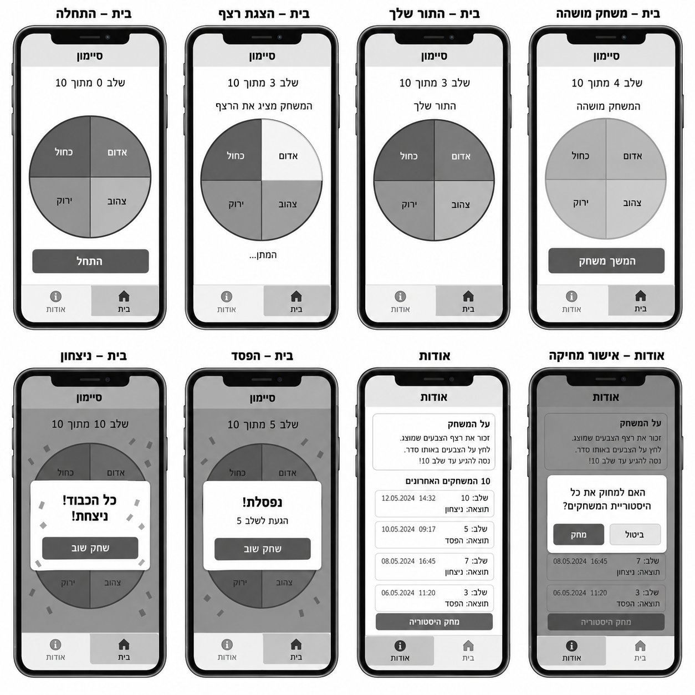
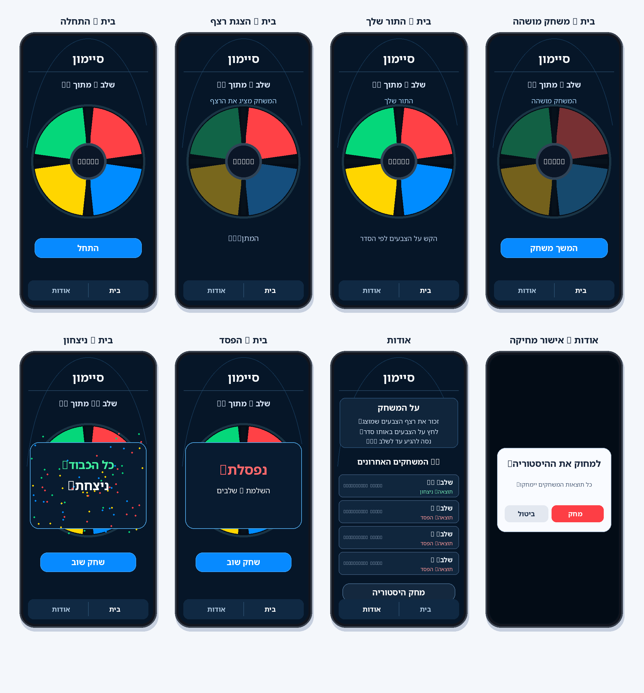
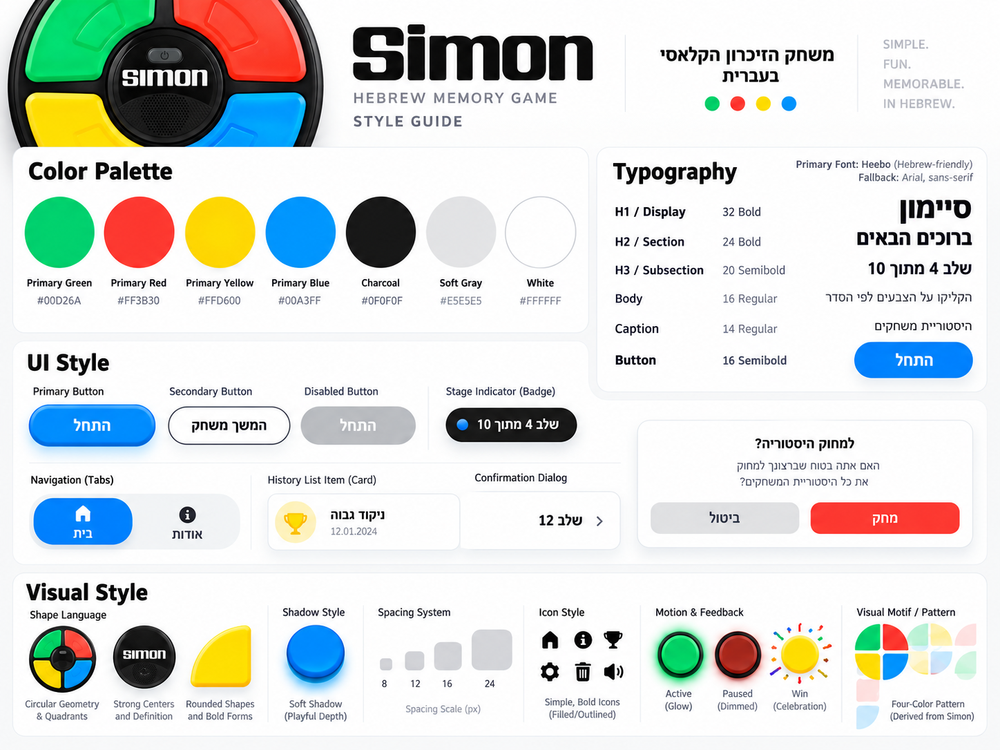

# DESIGN – משחק סיימון (Simon)

מסמך זה מגדיר את המימוש החזותי של ממשק המשחק בהתאם ל-PRD, ל-Wireframes, ל-Style Guide ול-Mockups. ה-PRD הוא המקור הקובע להתנהגות ולתכולת המוצר; ה-Wireframes קובעים את מבנה המסכים; ה-Style Guide מגדיר את השפה הגרפית; וה-Mockups מדגימים את היישום החזותי שלה. אם קיימת אי-התאמה בדוגמאות חזותיות, אין להסיק ממנה פיצ'רים נוספים או שינוי בכללֵי המשחק.

## 1. Screens – מסכי האפליקציה

האפליקציה כוללת **שני מסכים בלבד**: **בית** ו-**אודות**. שאר התצוגות בלוחות ההמחשה הן *מצבים של אותם מסכים* או חלונית אישור, ולא מסכים עצמאיים. כל התצוגות מיועדות ל-Smartphone במצב אנכי, ב-RTL.

### 1.1 בית – מסך המשחק

**מטרה:** לאפשר התחלת משחק, צפייה ברצף, שחזורו, המשך לאחר השהיה וקבלת תוצאת המשחק.

**מבנה ותוכן:**
- בחלק העליון כותרת המותג **"סיימון"**, ומתחתיה חיווי שלב בנוסח **"שלב 4 מתוך 10"**. אין Progress Bar.
- במרכז המסך לוח Simon עגול וגדול: ארבעה אזורים קשתיים, מופרדים בפסי מסגרת כהים, עם מרכז עגול כהה. לפי לוח ה-Mockups: **ירוק למעלה משמאל, אדום למעלה מימין, צהוב למטה משמאל, כחול למטה מימין**. צבעי המשחק הם ארבעת הצבעים בלבד.
- מתחת ללוח מופיע אזור משתנה לטקסט סטטוס ולהנחיית הפעולה הרלוונטית, ולאחריו כפתור פעולה כשהוא נדרש.
- בתחתית יש פס ניווט עקבי בעל שתי אפשרויות: **"בית"** ו-**"אודות"**; האפשרות הפעילה מובחנת חזותית.

**מצבי תצוגה:**

| מצב | תוכן ועיצוב | פעולה |
|---|---|---|
| לפני תחילת משחק | לוח מלא; חיווי שלב התחלתי; כפתור ראשי כחול **"התחל"** | התחלת המשחק |
| הצגת רצף | חיווי קצר כגון **"המשחק מציג את הרצף"**; כל אזור נדלק בתורו עם Glow בולט והאחרים מעומעמים; ללא כפתור משחק פעיל | המתנה לסיום ההצגה; לחיצות על אזורי הצבע חסומות |
| תור השחקן | חיווי **"התור שלך"**; הלוח מואר בצבעיו; ניתן להוסיף הנחיה קצרה **"הקש על הצבעים לפי הסדר"** | לחיצה על ארבעת אזורי הצבע לפי הרצף |
| מושהה | צבעי הלוח מעומעמים; חיווי **"המשחק מושהה"**; כפתור ראשי **"המשך משחק"** | חידוש ידני של השלב לפי ה-PRD |
| ניצחון | שכבת Overlay או Dialog מעל לוח המשחק, מסר **"כל הכבוד! ניצחת!"**, קונפטי צבעוני וכפתור **"שחק שוב"** | פתיחת משחק חדש |
| הפסד | שכבת Overlay או Dialog מעל הלוח, מסר **"נפסלת!"**, חיווי מספר השלבים שהושלמו וכפתור **"שחק שוב"**; ללא קונפטי | פתיחת משחק חדש |

Overlay הסיום משאיר את הלוח מזוהה ברקע וממקד את תשומת הלב בתוצאה. חיווי מספר השלבים שהושלמו נבדל מחיווי השלב שבו אירעה הטעות (לדוגמה, הפסד בשלב 5 לאחר השלמת ארבעה שלבים מוצג כתוצאה של **4 שלבים שהושלמו**).

**פעולות וניווט:** ניתן לעבור ל-**"אודות"** באמצעות פס הניווט. משחק פעיל מושהה בחזרה מהמעבר ונמשך רק לאחר לחיצה על **"המשך משחק"**. ניווט אינו מוסיף שלב, אינו יוצר תוצאת משחק ואינו משנה את הלוח. לצורכי העיצוב אין צורך בכפתורי הגדרות או סאונד.

### 1.2 אודות – הסבר, היסטוריה ומחיקה

**מטרה:** להציג הוראות משחק קצרות, את עשר התוצאות האחרונות ולאפשר מחיקת ההיסטוריה.

**מבנה ותוכן:**
- כותרת **"אודות"** באזור העליון.
- כרטיס הסבר **"על המשחק"** הכולל תיאור תמציתי והוראות בעברית.
- כותרת **"10 המשחקים האחרונים"** (או ניסוח שקול המבהיר את מגבלת העשר), ומתחתיה רשימת כרטיסי תוצאות, מן החדש לישן.
- בכל כרטיס: **תאריך ושעה**, **מספר השלבים שהושלמו** ו**"ניצחון"** או **"הפסד"**. מידע על תוצאה מוצג בטקסט ולא בצבע בלבד. בהיעדר משחקים, מופיע חיווי ריק קצר בעברית.
- מתחת להיסטוריה כפתור **"מחק היסטוריה"**, ובהמשך או בתחתית פס הניווט בעל האפשרויות **"בית"** ו-**"אודות"**. אם הרשימה ארוכה, גוללים בתוך עמוד המובייל; אין להאריך את גובה ה-Viewport המדומה.

**פעולות וניווט:** בחירה ב-**"בית"** חוזרת למשחק; בחירה ב-**"מחק היסטוריה"** פותחת חלונית אישור מעל מסך אודות.

### 1.3 אודות – Dialog לאישור מחיקה

**מטרה:** לאפשר אישור מודע לפני מחיקת ההיסטוריה.

**מבנה ותוכן:** שכבת Scrim כהה מעל התוכן, ובמרכז כרטיס Dialog בעל פינות מעוגלות עם השאלה **"למחוק את ההיסטוריה?"**, הסבר קצר ושני כפתורים: **"ביטול"** בגוון משני ו-**"מחק"** באדום. הכפתורים מסודרים באופן המתאים ל-RTL, בדומה להמחשות.

**פעולות:** **"ביטול"** סוגר את החלונית ללא שינוי; **"מחק"** מאשר את המחיקה, סוגר את החלונית ומעדכן את הרשימה. זו שכבת UI בתוך מסך אודות ולא מסך שלישי.

### 1.4 ניווט כללי

פס ניווט קבוע ועקבי מציג **"בית"** ו-**"אודות"**. כותרות המסכים, מיקום הפעולות וההפרדה בין תוכן למסגרת הניווט נשמרים בכל מצב. מעבר למסך אודות בעת משחק אינו מאפס את המשחק; בהמשך נדרש חידוש ידני. דוגמאות שונות של התקדמות, ניצחון והפסד אינן משנות את מבנה שני המסכים.

## 2. Style Guide – השפה העיצובית

### 2.1 Color Palette

ערכי ה-HEX הבאים נלקחו מה-Style Guide. ארבעת הצבעים הראשיים משמשים בעיקר בלוח המשחק ובהבהובים. צבעי המשטחים הכהים ב-Mockups מהווים התאמה חזותית של צבע ה-Charcoal; **אין ב-Style Guide קוד HEX מדויק לרקע הכחול-כהה**, ולכן אין להציג ערך משוער כערך מחייב.

| צבע | HEX | שימוש |
|---|---|---|
| Primary Green | `#00D26A` | האזור הירוק בלוח |
| Primary Red | `#FF3B30` | האזור האדום בלוח, פעולת מחיקה ומשוב הפסד |
| Primary Yellow | `#FFD600` | האזור הצהוב בלוח והדגשת הצלחה/קונפטי |
| Primary Blue | `#00A3FF` | האזור הכחול בלוח; בסיס לכפתור פעולה ראשי והדגשת בחירה |
| Charcoal | `#0F0F0F` | מסגרות כהות, מרכז הלוח, הפרדות ועומק |
| Soft Gray | `#E5E5E5` | טקסט או משטחים משניים בהתאם לניגודיות |
| White | `#FFFFFF` | טקסט בולט על רקע כהה ומשטחי Dialog בהירים כשנדרש |

**יישום לפי ה-Mockups:** רקע האפליקציה הוא כחול-שחור עמוק; כרטיסי תוכן ופס הניווט בגוון כהה מעט בהיר יותר, עם קווי מתאר כחולים עדינים. כפתורי פעולה ראשיים כחולים, טקסט בהיר, והצבעים הרוויים מרוכזים בלוח. ההדגשות של Active/Pressed משתמשות בהארה וב-Glow, ולא בהחלפה אקראית של ארבעת צבעי המשחק.

### 2.2 Typography

- **משפחה ראשית:** `Heebo`, התומכת בעברית. **Fallback:** `Arial, sans-serif`.
- **H1 / Display:** `32px`, `Bold` – כותרת בולטת או מסר סיום.
- **H2 / Section:** `24px`, `Bold` – כותרות אזורים.
- **H3 / Subsection:** `20px`, `Semibold` – חיווי שלב או כותרת משנה.
- **Body:** `16px`, `Regular` – הוראות, תוכן ותיאורים.
- **Caption:** `14px`, `Regular` – תאריך ושעה, פרטי תוצאה ומידע משני.
- **Button:** `16px`, `Semibold` – כיתובי פעולות.

היררכיית הטקסט צריכה להתאים למסך טלפון: כותרות קצרות, מסרים ממוקדים, וריווח ברור בין חיווי השלב, הלוח וכפתור הפעולה. השם **"סיימון"** מוצג ככותרת מותג עברית. סמל המילה האנגלי בתמונת ההשראה משמש השראה גרפית ואינו מחליף טקסט ממשק בעברית.

### 2.3 UI Style

- **לוח המשחק:** עיגול בעל ארבעה Quadrants קשתיים, שקועים במסגרת כהה, עם הפרדה עבה למניעת בלבול בין אזורי מגע. במרכז דיסק כהה; אין בו פיצ'ר נוסף. הארה צבעונית משקפת את הצגת הרצף ואת לחיצת השחקן.
- **Primary Button:** כפתור כחול מלא, רחב, עם קצוות מעוגלים, טקסט לבן מודגש ועומק/צל רך. משמש **"התחל"**, **"המשך משחק"** ו-**"שחק שוב"** לפי המצב.
- **Secondary / Destructive Button:** פעולות משניות במשטח או קו מתאר מאופק; **"מחק"** בחלונית מאופיין באדום. אין ליצור כפתורי פעולה שאינם מופיעים במסכים.
- **Disabled / Inactive:** מראה מעומעם, ללא Glow. בזמן הצגת הרצף חיווי ההארה הוא חזותי בלבד מבחינת קלט המשתמש.
- **History Cards:** כרטיסים כהים עם גבול עדין, פינות מעוגלות, חלוקה ברורה לנתונים והדגשה מאופקת של ניצחון/הפסד.
- **Navigation:** פס תחתון דו-אפשרותי, כהה, עם הפרדה ומצב פעיל בולט. איקונים פשוטים, אם משתמשים בהם, הם משניים לתוויות בעברית.
- **Dialog:** כרטיס מרוכז על גבי Scrim; גבול ופינות מעוגלים; היררכיה ברורה בין הכותרת, ההסבר והכפתורים. ב-Mockup לאישור המחיקה ה-Dialog בהיר, בניגוד לשאר הממשק הכהה.
- **שדות קלט:** אין שדות קלט במוצר, ולכן לא נדרש סגנון עבורם.

### 2.4 Visual Style

- **Shape Language:** גיאומטריה עגולה בהשראת מכשיר Simon המקורי; כפתורים וכרטיסים מעוגלים, קווים ברורים ומרכז לוח כהה.
- **Layout:** קומפוזיציה אנכית המתאימה למסך Smartphone – כותרת וחיווי למעלה, לוח גדול במרכז, מסר ופעולה מתחתיו, ניווט בתחתית. רשימת ההיסטוריה גוללת במידת הצורך.
- **Spacing:** סולם הריווח המופיע ב-Style Guide הוא `8 / 12 / 16 / 24px`. השתמש בו באופן עקבי בין רכיבים, בין כרטיסים ובתוכן הפנימי.
- **Corners & Borders:** פינות מעוגלות בכפתורים, כרטיסים ו-Dialog; פסי הפרדה כהים ועבים בין אזורי הלוח; קווי מתאר כחולים עדינים סביב משטחים כהים.
- **Shadows & Glow:** צללים רכים מעניקים עומק לכפתורים וללוח; Glow ממוקד מופיע על אזור משחק פעיל. מצבי Pause ו-Disabled מעומעמים.
- **Motion & Feedback:** מעבר הארה קצר של אזורי הצבע, בקצב הצגת הרצף המוגדר במשחק; קונפטי רב-צבעי מעל חלונית הניצחון בלבד. אין להוסיף אנימציות המשנות את הסדר או את מספר הצבעים.
- **Iconography:** אייקונים פשוטים ובעלי קו ברור, לפי דוגמאות ה-Style Guide, רק היכן שמופיע צורך ניווטי/חזותי קיים. לא מוסיפים אייקוני הגדרות, מתג צלילים או יכולות נוספות.
- **Images & Illustrations:** הלוח עצמו הוא האלמנט החזותי המרכזי; אין צורך בצילום רקע או באיור דקורטיבי עצמאי. יש לשמור על האופי המשחקי והזוהר בלי להעמיס על מסכי המובייל.

### 2.5 Language & Direction

- הממשק בעברית בלבד, עם `dir="rtl"` ויישור טקסט תואם.
- כותרות, פעולות, הודעות מצב וטקסטי Dialog בעברית. את הכיתוב האנגלי **Simon** שב-Inspiration Board אין להעביר כמחרוזת UI מחייבת.
- מספרים ותאריכים מוצגים בסדר קריא; ניתן להשתמש בבידוד כיווניות למקטעים מספריים בתוך שורה עברית.
- סדר הצבעים הוא **מרחבי** (לפי מיקומם בלוח), ואינו מתהפך בגלל כיווניות RTL.

### 2.6 הערות התאמה בין ההמחשות

- ה-Mockups מציגים **Theme כהה**, בשעה שה-Style Guide מציג גם דוגמאות על רקע לבן. במסכי האפליקציה יש להעדיף את ה-Theme הכהה של ה-Mockups, תוך שימוש בצבעים ובטיפוגרפיה של ה-Style Guide.
- כיתובים מספריים לא קריאים או משובשים בחלק מהתמונות הם מגבלה של ההמחשה בלבד; במימוש יש להציג מחרוזות עבריות תקינות ומספרי שלבים תקינים, עד 10.
- דוגמת כרטיס עם שלב 12 ב-Style Guide אינה דרישה למוצר; נתוני ההיסטוריה וחיווי המשחק מוגבלים לדרישות ה-PRD.
- כל מצב שמתואר בלוח הוא מצב של **בית** או **אודות** בלבד, ולא מסך נוסף.
